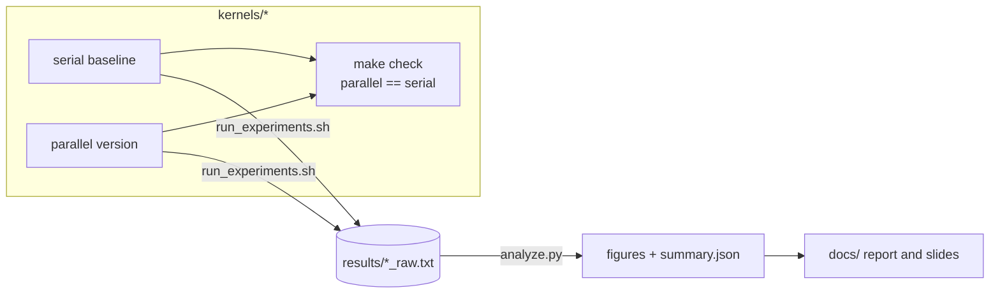
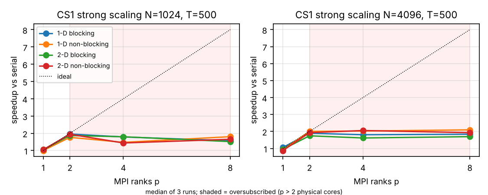

# ParaForge: HPC Kernel Suite

[](https://github.com/Fatima-Ijaz/ParaForge-HPC-Kernel-Suite-/actions/workflows/ci.yml)
  

Five realistic compute kernels, each implemented as a serial baseline and a parallel version
in **OpenMP** (shared memory) or **MPI** (distributed memory), then measured, checked against
the serial output and analysed to see *why* each one scales the way it does.

| Kernel | Domain | Model | Parallel strategy |
|---|---|---|---|
| [`heat-diffusion-mpi`](kernels/heat-diffusion-mpi) | Weather / PDE solver | MPI | 1-D and 2-D domain decomposition, halo exchange, compute/communication overlap |
| [`kmer-counting-openmp`](kernels/kmer-counting-openmp) | Genomics | OpenMP | Chunked data parallelism, atomics vs. private histograms, false sharing |
| [`monte-carlo-pricing`](kernels/monte-carlo-pricing) | Quantitative finance | OpenMP + MPI | Independent RNG streams via jump-ahead, reproducible reductions |
| [`pagerank-openmp`](kernels/pagerank-openmp) | Graph analytics | OpenMP | Pull vs. push on CSR, dynamic scheduling for power-law graphs |
| [`sample-sort-mpi`](kernels/sample-sort-mpi) | Big-data sorting | MPI | Sample sort, `Alltoallv` redistribution, latency/bandwidth cost model |

## How the pieces fit together



Every kernel follows the same contract:

1. A **serial baseline**, compiled with the same flags as the parallel code. Speedup is always
   `T_serial / T_p`, never the parallel code on one thread.
2. A **parallel version** that is verified against the serial result (exact match for integers
   and for the stencil, an explicit tolerance for floating-point sums).
3. A **Makefile** with `make`, `make check` and `make clean`.
4. A **`run_experiments.sh`** that produces the raw timing lines. Each configuration is run three
   times and the median is used.

## Headline results

Measured on a 2-core virtual machine (details below), so the interesting range is `p <= 2`.
Beyond that the runs are oversubscribed and mostly show overhead.

| Kernel | Best 2-worker result | What limits it |
|---|---|---|
| Heat diffusion, N = 4096 | speedup 2.01 (1-D, non-blocking) | memory bandwidth, then halo synchronisation |
| k-mer counting, k = 8 | speedup 1.93 with private histograms (atomics: 0.28) | atomic cost and cache-line traffic |
| Monte Carlo, M = 10^8 | speedup 1.98, efficiency 0.99 | almost nothing, estimated serial fraction 1.1 % |
| PageRank, 1M vertices / 16.8M edges | speedup 2.12 pull + dynamic (static: 1.45) | load imbalance, then random-access latency |
| Sample sort, N = 10^8 | speedup 1.77 (uniform keys) | extra O(N) exchange and merge work |

The full analysis, including the strong and weak scaling tables, is in
[`docs/analysis.md`](docs/analysis.md), the decomposition diagrams are in
[`docs/architecture.md`](docs/architecture.md), and the complete write-up is in
[`docs/study-report.docx`](docs/study-report.docx).



## Getting started

Requirements: a C/C++ toolchain with OpenMP (`gcc`/`g++`), an MPI implementation (Open MPI or
MPICH) and, for the plots, Python 3 with `matplotlib`. Linux, macOS or WSL work; on Ubuntu:

```bash
sudo apt install build-essential openmpi-bin libopenmpi-dev python3-matplotlib
```

Build and self-check everything:

```bash
make            # builds all five kernels
make check      # runs each kernel's correctness check against its serial baseline
```

Or one kernel at a time:

```bash
cd kernels/heat-diffusion-mpi
make
mpirun -np 4 ./parallel 1024 500 50 2 nb      # N, steps, check interval, 2-D, non-blocking
```

Re-running the benchmarks and regenerating every figure:

```bash
cd kernels/pagerank-openmp && ./run_experiments.sh      # writes results/cs4_raw.txt
python3 results/analyze.py                              # medians, speedup tables, figures
```

If you run MPI as root (for example in a container), export
`OMPI_ALLOW_RUN_AS_ROOT=1 OMPI_ALLOW_RUN_AS_ROOT_CONFIRM=1`. Run with more ranks than physical cores
only with `--oversubscribe`, and treat those numbers as overhead measurements, not speedup.

## Measurement setup

| | |
|---|---|
| CPU | Intel Xeon @ 2.10 GHz, KVM virtual machine |
| Cores | 2 physical, 2 logical (1 thread per core) |
| Memory | 7.7 GB |
| OS | Ubuntu 24.04 |
| Compiler | gcc 13.3.0, `-O3 -march=native` for serial and parallel builds alike |
| MPI | Open MPI 4.1.6, shared-memory (vader) transport |
| Method | median of 3 runs; only compute and communication are timed, input generation is excluded |

Run-to-run noise on a shared VM is around 5 to 10 % for the memory-bound kernels, which is
worth keeping in mind when reading small differences.

## Repository layout

```
kernels/
  heat-diffusion-mpi/      serial.c  parallel.c  verify.c  Makefile  run_experiments.sh
  kmer-counting-openmp/    serial.c  parallel.c  kmer_common.h  ...
  monte-carlo-pricing/     serial.c  parallel.c  parallel_mpi.c  mc_common.h  ...
  pagerank-openmp/         serial.c  parallel.c  graph.h  ...
  sample-sort-mpi/         serial.cpp  parallel.cpp  pingpong.c  keys.h  ...
results/                   raw timing output, analyze.py, figures, summary.json
docs/                      architecture, analysis, report and slides
.github/workflows/         CI: build and run every correctness check
```

## Team

See [`CONTRIBUTIONS.md`](CONTRIBUTIONS.md) for who owned and reviewed which kernel.

## License

MIT, see [`LICENSE`](LICENSE).
