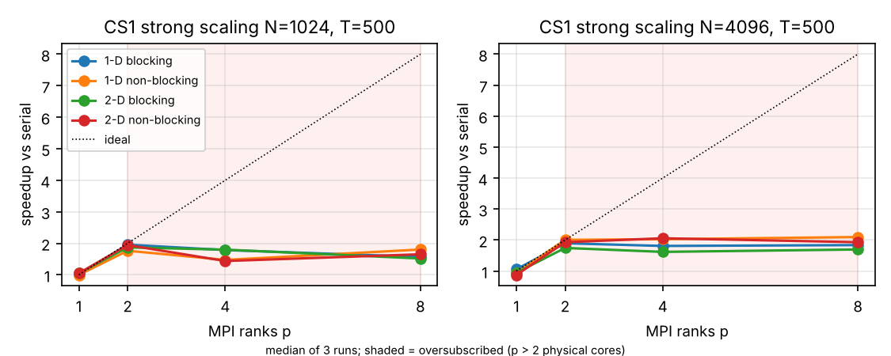
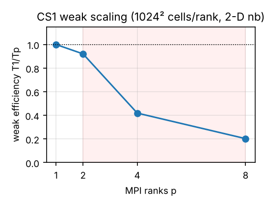
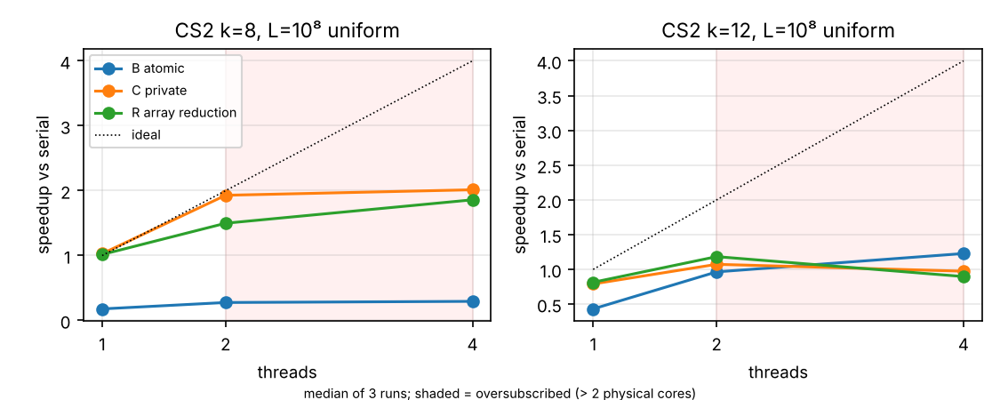
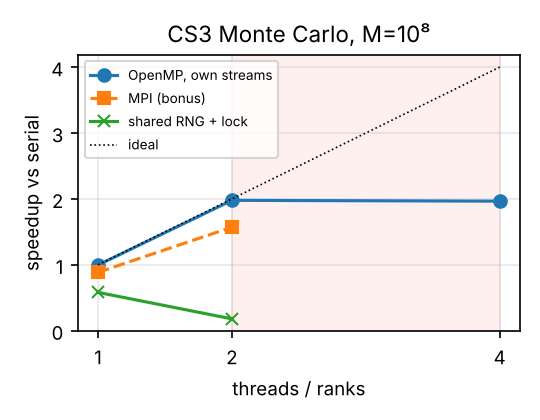
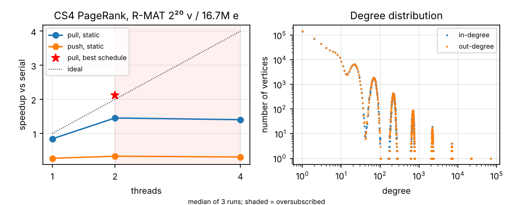
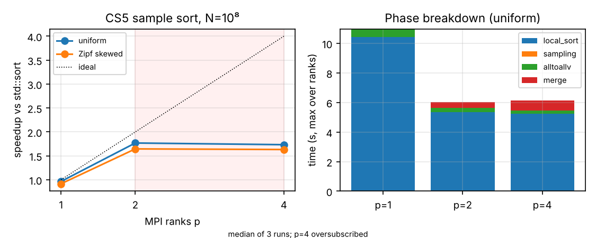

# Performance analysis

All numbers come from the raw files in [`results/`](../results) (median of 3 runs) on a 2-core
virtual machine. Speedup is `S(p) = T_serial / T_p` against the separate serial program, and
efficiency is `E(p) = S(p) / p`. Runs with p above 2 are oversubscribed, so only p <= 2 says
anything about scaling; larger p shows the overhead of sharing two cores.

## Cross-kernel comparison

| Kernel | Model | Best result at p = 2 | Dominant bottleneck |
|---|---|---|---|
| Heat diffusion (N = 4096) | MPI | S = 2.01, E = 1.00 (1-D non-blocking) | memory bandwidth, then halo synchronisation |
| k-mer counting (k = 8) | OpenMP | S = 1.93, E = 0.96 (private histograms) | atomic cost / false sharing; latency at k = 12 |
| Monte Carlo (M = 10^8) | OpenMP, MPI | S = 1.98, E = 0.99 | none to speak of (serial fraction 1.1 %) |
| PageRank (16.8 M edges) | OpenMP | S = 2.12 (pull, dynamic,1024) vs. 1.45 static | load imbalance, then random-access latency |
| Sample sort (N = 10^8) | MPI | S = 1.77, E = 0.88 (uniform keys) | extra O(N) exchange and merge, skew for Zipf keys |

Monte Carlo scales best: all work is independent and the only communication is a 16-byte
reduction. Heat diffusion is next because halo data is under 1 % of the data touched per step.

## Heat diffusion, N = 4096, strong scaling

| Variant | p = 1 | p = 2 | p = 4 | p = 8 |
|---|---|---|---|---|
| 1-D blocking | 13.33 s | 7.41 s (S 1.90) | 7.76 s (S 1.81) | 7.64 s (S 1.84) |
| 1-D non-blocking | 14.95 s | 7.00 s (S 2.01) | 6.93 s (S 2.03) | 6.70 s (S 2.10) |
| 2-D blocking | 14.84 s | 8.05 s (S 1.75) | 8.68 s (S 1.62) | 8.28 s (S 1.70) |
| 2-D non-blocking | 16.06 s | 7.28 s (S 1.93) | 6.83 s (S 2.06) | 7.27 s (S 1.93) |

Serial: 14.04 s. Efficiency falls below 0.70 at p = 4 for every variant. A simple model
`T_p ~ T_comp / p + T_comm` explains p = 2 (13.33 / 2 + 0.70 = 7.37 s against 7.41 s measured);
at p = 4 the compute part cannot drop below 13.33 / 2 s because there are only two cores.




## k-mer counting, speedup over serial (uniform sequence, L = 10^8)

| k | Version | 1 thread | 2 threads | 4 threads (oversubscribed) |
|---|---|---|---|---|
| 8 (serial 0.125 s) | B atomic | 0.18 | 0.28 | 0.29 |
| | C private | 1.03 | 1.93 | 2.01 |
| | R reduction | 1.02 | 1.50 | 1.86 |
| 12 (serial 0.640 s) | B atomic | 0.43 | 0.96 | 1.23 |
| | C private | 0.79 | 1.07 | 0.97 |
| | R reduction | 0.81 | 1.18 | 0.90 |



## Monte Carlo

| Workers | Time | Speedup | Efficiency |
|---|---|---|---|
| serial | 3.097 s | 1.00 | n/a |
| OpenMP 1 | 3.108 s | 1.00 | 1.00 |
| OpenMP 2 | 1.566 s | 1.98 | 0.99 |
| OpenMP 4 (oversubscribed) | 1.576 s | 1.97 | 0.49 |
| MPI 1 / 2 | 3.498 s / 1.971 s | n/a | n/a |



## PageRank

Static scheduling leaves one thread with 76 % of the edges at p = 2. Dynamic scheduling with
chunk 1024 gives the best pull time (0.525 s, speedup 2.12). The push variant is about four times
slower than pull in its best configuration because every update is an atomic compare-and-swap on
a random location.



## Sample sort

| Uniform keys | Total | Local sort | Exchange | Merge | Speedup |
|---|---|---|---|---|---|
| std::sort | 10.69 s | 10.44 s | n/a | n/a | 1.00 |
| p = 2 | 6.04 s | 5.35 s | 0.29 s | 0.40 s | 1.77 |
| p = 4 (oversubscribed) | 6.17 s | 5.23 s | 0.24 s | 0.66 s | 1.73 |



## Reproducing the figures

```bash
python3 results/analyze.py        # reads results/*_raw.txt, writes results/fig_*.png and summary.json
python3 results/diagrams.py       # regenerates docs/images/diag_cs*.png
```
