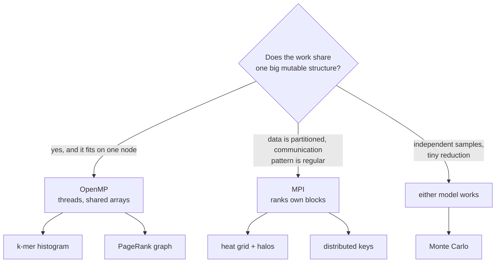
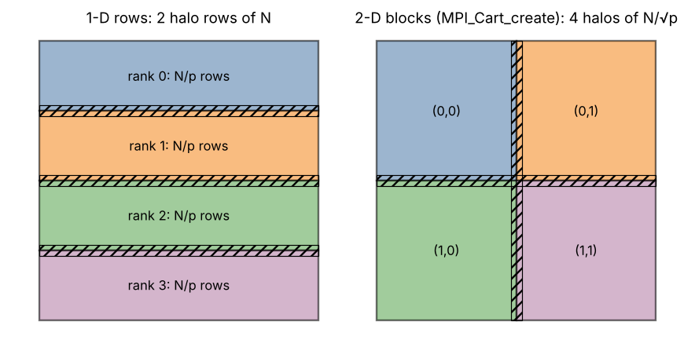
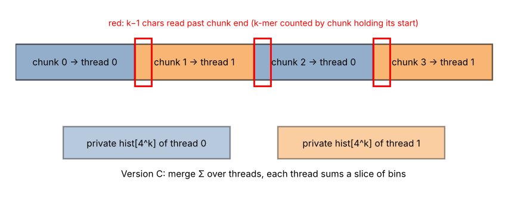
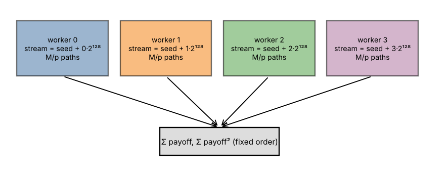
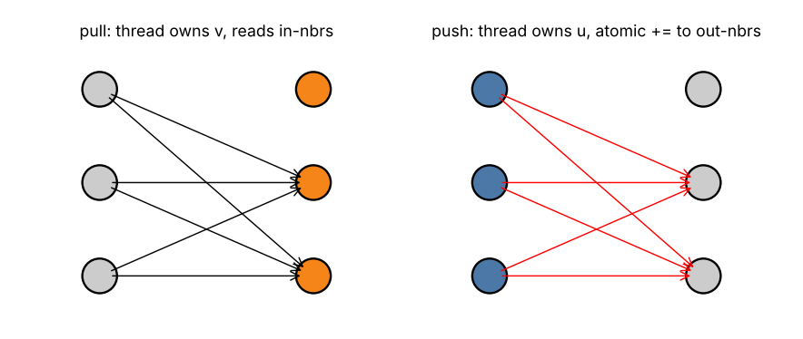
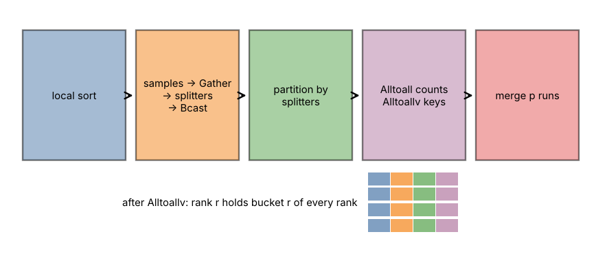

# Architecture and decomposition

This page shows, for each kernel, who owns which data and what is communicated. The source
files carry a header comment with the same information next to the code.

## Choosing a programming model



| Kernel | Model | Why |
|---|---|---|
| Heat diffusion | MPI | regular grid, neighbour-only communication, scales beyond one node |
| k-mer counting | OpenMP | one large shared histogram; the interesting question is how to update it |
| Monte Carlo | OpenMP and MPI | no sharing at all, so both fit; implemented twice to compare |
| PageRank | OpenMP | graph and rank vectors are shared and read randomly; partitioning a power-law graph for MPI is hard |
| Sample sort | MPI | data is distributed by definition; redistribution is an all-to-all |

## Heat diffusion: domain decomposition



The hatched strips are the halo (ghost) cells. In the 1-D layout every interior rank swaps two
rows of N values per step; in the 2-D layout it swaps four edges of about N / sqrt(p) values.

## k-mer counting: chunk ownership and private histograms



## Monte Carlo: independent streams



## PageRank: pull vs. push access patterns



## Sample sort: pipeline



## Communication cost model used for sample sort

One-way message time is modelled as `T(m) = alpha + beta * m`, with alpha (latency) and beta
(seconds per byte) fitted from a ping-pong run. For the `Alltoallv` the model is extended with
a per-byte term gamma for first-touching the freshly allocated receive buffer:

```
T_alltoallv  ~  (p - 1) * alpha + beta * m_remote + gamma * m_recv
```

On the test machine this predicted 0.282 s against 0.291 s measured at p = 2.
