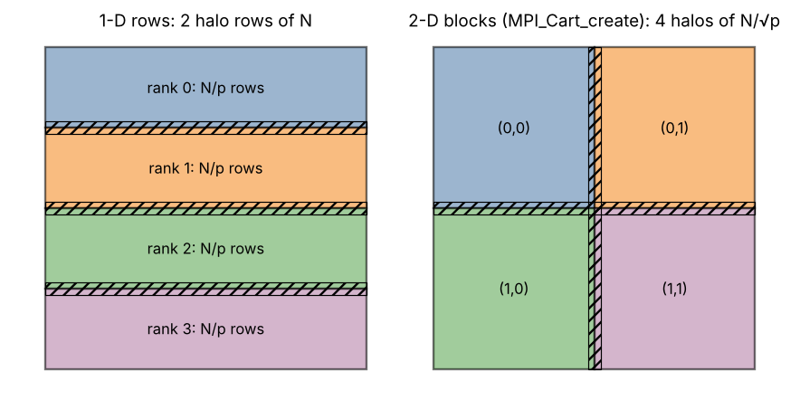
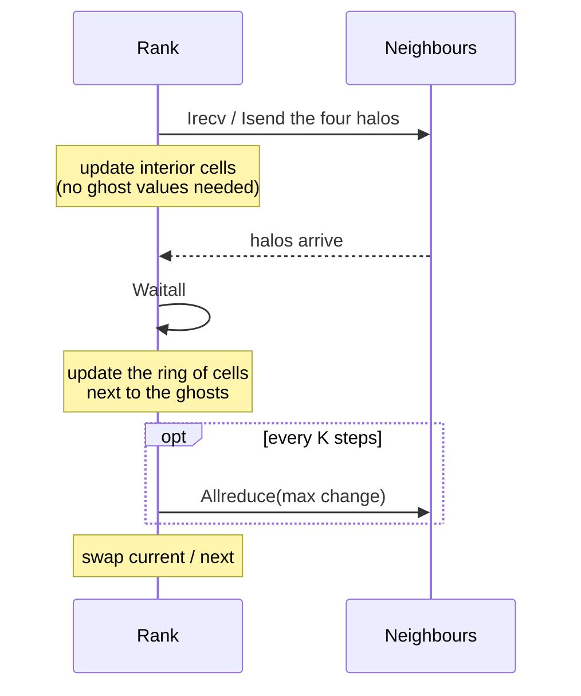

# Heat diffusion (MPI)

Explicit 5-point stencil on an N x N plate, parallelised with MPI domain decomposition.

```
next[i][j] = cur[i][j] + alpha * (cur[i-1][j] + cur[i+1][j] + cur[i][j-1] + cur[i][j+1] - 4 * cur[i][j])
```

The top edge is held at 100, the other edges at 0 (alpha = 0.2). Every cell depends only on its
four neighbours from the previous step, so the grid can be cut into blocks that only need to swap
their borders.

## Decomposition



Each rank keeps its block plus a one-cell ghost frame. Per step an interior rank communicates:

| Decomposition | Cells computed | Halo values exchanged | Comm / compute |
|---|---|---|---|
| 1-D row bands | N^2 / p | about 2N | 2p / N |
| 2-D blocks (sqrt(p) x sqrt(p)) | N^2 / p | about 4N / sqrt(p) | 4 sqrt(p) / N |

The 2-D layout sends fewer values once p > 4, at the price of strided column messages.

### One time step with overlap (`nb` mode)



## Build and run

```bash
make            # serial, parallel, verify
make check      # serial vs. every decomposition/mode on 1, 2 and 4 ranks, bitwise compare
```

| Program | Command |
|---|---|
| serial | `./serial N T K [out.bin]` |
| parallel | `mpirun -np P ./parallel N T K DECOMP MODE [out.bin]` |
| verify | `./verify a.bin b.bin N` |

* `DECOMP`: `1` = row bands, `2` = 2-D blocks (`MPI_Dims_create` + `MPI_Cart_create`)
* `MODE`: `b` = blocking `MPI_Sendrecv`, `nb` = `MPI_Isend`/`MPI_Irecv` with the interior update overlapped
* `K`: maximum-change check with `MPI_Allreduce` every K steps (0 = never)

Parameters used for the measurements: N in {1024, 4096}, T = 500, K = 50 (K in {0, 1, 50} for the
convergence-check test); weak scaling uses N = 1024 * sqrt(p), i.e. 1024, 1448, 2048, 2896.
`./run_experiments.sh` writes `../../results/cs1_raw.txt` (3 repetitions, median reported).

Output fields: `time` is the maximum over ranks between two barriers, `comm` is the time spent in
halo-exchange calls, `allreduce` is the time in the convergence check.

## Verification

The gathered MPI result is compared with the serial grid. Because the stencil is evaluated in the
same order, the grids are bitwise identical for both decompositions, both modes and
p = 1, 2, 3, 4, 6, including sizes where N is not divisible by p.

## What the measurements show (2-core VM)

* N = 4096, p = 2: 1-D non-blocking reaches speedup 2.01 (efficiency 1.00); 2-D non-blocking 1.93.
* Non-blocking halves the measured halo time at N = 4096 (0.70 s to 0.33 s), but helps little at
  N = 1024: the messages are tiny, shared-memory transport copies with the CPU, and Open MPI
  only progresses messages inside MPI calls.
* Checking convergence every step costs 1.5x to 2.7x. At p = 2 the `Allreduce` itself is only
  5 to 82 ms; most of the cost is the extra `fabs`/compare per cell, which also blocks
  vectorisation. Every 50 steps it is not measurable.
* Weak scaling efficiency: 1.00, 0.92 at p = 2, then 0.42 and 0.20 once ranks outnumber cores.
