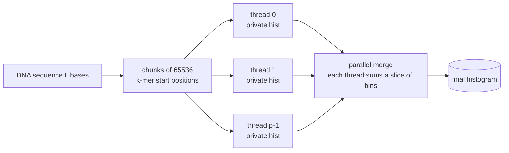

# k-mer counting (OpenMP)

Counts how often every length-k substring (k-mer) occurs in a DNA sequence over {A, C, G, T}.
Each base takes 2 bits, so a k-mer is an integer and the result is a histogram with 4^k bins.
It is the first step of genome assembly and sequence comparison.

The counting itself is embarrassingly parallel; the interesting part is what many threads do
when they all want to increment the same histogram bin.

## Strategies compared

| Version | Idea | Memory | Outcome |
|---|---|---|---|
| `A` | `omp parallel for`, unprotected `hist[i]++` | 4^k ints | **wrong on purpose**: lost updates (data race) |
| `B` | `#pragma omp atomic` on every increment | 4^k ints | correct, slow at small k (contended cache lines) |
| `C` | private histogram per thread, parallel merge | p x 4^k ints | correct, fastest while the copies fit in cache |
| `R` | OpenMP array-section `reduction(+:h[:4^k])` | p x 4^k ints | like C, compiler-generated |
| `F` | false-sharing experiment, counters at a chosen stride | p x stride | shows cache-line ping-pong and the fix |



### Chunk boundaries

Chunks are defined by the position where a k-mer *starts*. Each chunk reads k-1 extra bases past
its end, so a k-mer that straddles a border belongs to exactly one chunk and is counted once.

## Build and run

```bash
make            # serial and parallel
make check      # B, C, R must PASS; A is expected to FAIL with 2 threads
```

```bash
./serial L k [u|s] [hist.bin]
OMP_NUM_THREADS=p ./parallel L k [u|s] VERSION [pad]
```

* `L` sequence length, `k` k-mer length, `u` uniform or `s` skewed bases (A 55 %, C 20 %, G 15 %, T 10 %), fixed seed 12345
* `VERSION` is `A`, `B`, `C`, `R` or `F`; for `F`, `pad` is the stride in `uint32` (0 = adjacent, 16 = one 64-byte line per thread)
* every parallel run is compared bin by bin against a serial recount (untimed) and printed as `PASS`/`FAIL`

Measurement parameters: L = 10^8, k in {8, 12}, `OMP_PROC_BIND=close OMP_PLACES=cores`.
`./run_experiments.sh` writes `../../results/cs2_raw.txt`. Version `R` at k = 12 puts a 64 MB array
on each thread stack, so the script raises the stack limit (`ulimit -s unlimited`, `OMP_STACKSIZE=256M`).

## What the measurements show (2-core VM)

* **Race damage.** With two threads version A loses 17.5 % of all counts at k = 2, 2.0 M at k = 6
  and 15,726 at k = 8; at k = 12 only 9 counts. Fewer bins means more collisions.
* **Atomic vs. private at k = 8** (256 KiB histogram, fits in L2): C reaches speedup 1.93, B only
  0.28, because an atomic costs about 7 ns against 1.2 ns for a plain increment.
* **Crossover at k = 12** (64 MiB histogram): private copies no longer fit in cache and the merge
  moves (2p + 1) x 64 MiB, so B (0.66 s) and C (0.60 s) end up close together at p = 2.
* **False sharing** (k = 1, 16 bytes of counters per thread): unpadded 0.166 s, padded to a
  cache line 0.064 s with two threads, a 2.6x improvement.
* **Limit.** k = 8 runs at about 800 M k-mers/s serially (about 2.6 cycles per k-mer), which is
  compute bound; k = 12 drops to about 156 M k-mers/s because every update is a random access
  into a 64 MiB table, so it is bound by memory latency.
