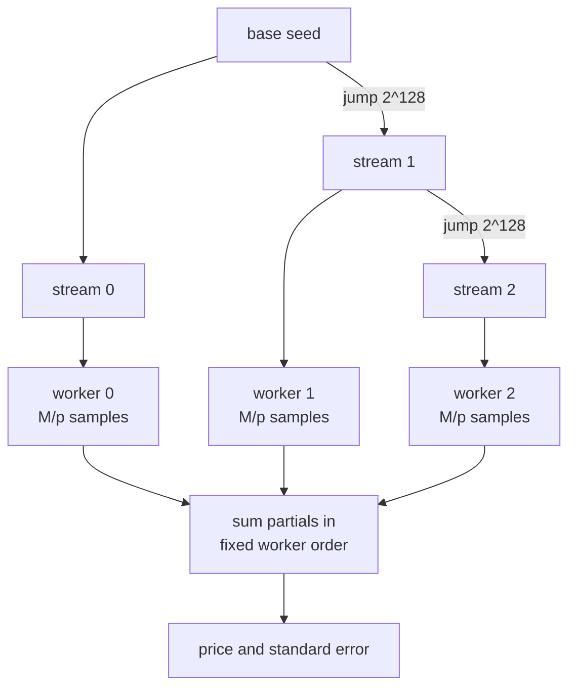

# Monte Carlo option pricing (OpenMP and MPI)

Prices a European call on a stock that follows geometric Brownian motion:

```
S_T = S0 * exp((r - sigma^2 / 2) * T + sigma * sqrt(T) * Z),   Z ~ N(0, 1)
price = exp(-rT) * mean(max(S_T - K, 0))       over M independent paths
```

Parameters: S0 = 100, K = 100, r = 5 %, sigma = 20 %, T = 1 year. The Black-Scholes closed form
gives 10.450584, which the estimate is compared with (together with its standard error).

## Parallel design

The paths are independent, so each worker takes a contiguous share of the M samples and keeps a
private sum and sum of squares. The only communication is one 16-byte reduction at the end.

The part that needs care is random numbers. Every worker needs its own stream, and the streams
must not overlap. xoshiro256** has a `jump()` that advances the state by 2^128 steps, so worker w
simply uses the base-seed stream advanced by w jumps.



Because the shares, the streams and the summation order are fixed, the same seed and the same
number of workers always produce the same bits. A different worker count uses different streams,
so the price moves by roughly one standard error.

## Build and run

```bash
make            # serial, parallel (OpenMP), parallel_mpi
make check      # serial == 1-thread parallel, p=2 reproducible, MPI p=2 runs
```

```bash
./serial M [seed]
OMP_NUM_THREADS=p ./parallel M [seed] [good|sameseed|shared]
mpirun -np p ./parallel_mpi M [seed]
```

`sameseed` and `shared` are the deliberately wrong RNG schemes (all workers on the same stream,
and one generator behind a lock). Measurement parameters: M = 10^8, seed 2026.
`./run_experiments.sh` writes `../../results/cs3_raw.txt`.

## What the measurements show (2-core VM)

* **Scaling.** Speedup 1.98 and efficiency 0.99 at two threads; the apparent serial fraction
  from Amdahl's law is 1.1 %, mostly frequency and virtualisation effects.
* **Shared generator.** For M = 10^7 the locked generator takes 0.53 s with one thread and
  1.73 s with two; independent streams need 0.18 s.
* **Same seed everywhere.** With 8 workers on the same stream the reported standard error is
  0.00466 but the real spread over 20 trials is 0.01604, about 3.4 times too optimistic.
* **Accuracy per second.** Two workers evaluate twice as many paths in the same time, which only
  shrinks the standard error by sqrt(2) = 1.41 (0.00147 to 0.00104); accuracy per second
  (1 / SE^2) improves by the full speedup.
* **MPI vs. OpenMP.** Same price to the last digit with 2 workers (10.4471186717). MPI was
  13 to 25 % slower here, mostly process start-up, barriers and the gather.

Generator reference: D. Blackman and S. Vigna, "Scrambled linear pseudorandom number generators",
ACM Transactions on Mathematical Software 47(4), 2021.
