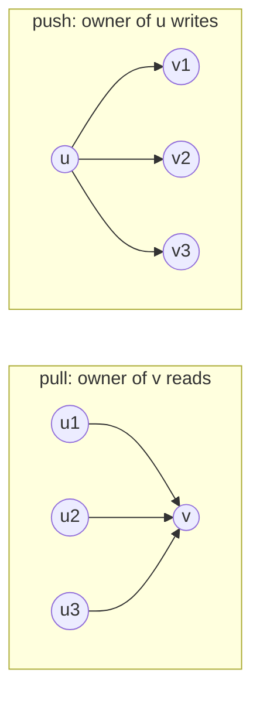

# PageRank (OpenMP)

Iterative PageRank with damping d = 0.85 on a power-law graph stored in CSR (compressed sparse
row) format. Iteration stops when the L1 change between two rank vectors falls below 1e-9.

```
r_new[v] = (1 - d) / n + d * ( sum over in-neighbours u of r[u] / outdeg(u)  +  dangling / n )
```

Vertices without out-edges ("dangling") would leak rank, so their combined rank is spread evenly
over all vertices each iteration.

## Input graph

Synthetic R-MAT graph, (a, b, c, d) = (0.57, 0.19, 0.19, 0.05), scale 20 (1,048,576 vertices),
edge factor 16, seed 42, self-loops removed: 16,776,058 edges, 500,991 dangling vertices. It is
stored twice, as out-CSR (for push) and in-CSR (for pull). Vertex ids are not shuffled, so the
busy vertices have small ids, as in the raw R-MAT model.

## Pull vs. push



| | Pull | Push |
|---|---|---|
| Thread owns | destination vertices | source vertices |
| Writes | one writer per element, no conflicts | many threads may hit one vertex, `omp atomic` |
| Reads | random reads of `c[u]` | sequential |
| Pressure point | latency of dependent random loads | atomic compare-and-swap, cache-line ownership |

## Build and run

```bash
make            # serial and parallel
make check      # 2^16-vertex graph: pull and push must match the serial ranks
```

```bash
./serial scale edgefactor [ranks.bin] [degrees.txt]
OMP_NUM_THREADS=p ./parallel scale edgefactor pull|push|pushplain static|dynamic|guided CHUNK [ranks.bin]
```

`pushplain` is push without atomics, only valid with one thread, used to isolate the atomic cost.
The program prints the per-thread imbalance `R_time` (slowest thread / mean thread) and
`R_edges_static` (the same ratio computed from edge counts of equal static blocks); with
`ranks.bin` it also checks the maximum and L1 difference against the serial ranks.

Measurement parameters: scale 20, edge factor 16, threads 1, 2, 4, schedule sweep at p = 2.
`./run_experiments.sh` writes `../../results/cs4_raw.txt` and `../../results/cs4_degrees.txt`.

## What the measurements show (2-core VM)

* **Irregular work.** About 48 % of the vertices have no out-edges, while the largest in-degree
  is 68,982 against an average of 16. With equal static blocks, thread 0 gets 76 % of the edges at
  p = 2 (edge imbalance 1.52, measured time imbalance R = 1.40).
* **Scheduling.** Static pull reaches only 1.45. `dynamic,1024` reaches 2.12 (0.525 s).
  Chunk size 1 is dominated by scheduling overhead (10^6 requests per iteration), and very large
  chunks bring the imbalance back.
* **Pull vs. push.** The best push (`dynamic,4096`) takes 2.1 s against 0.525 s for pull. With one
  thread, atomics alone turn 1.54 s into 4.12 s, about 6 ns per edge for the CAS loop.
* **Memory.** Pull moves roughly 15 bytes per edge if `c[u]` is cached (up to about 70 if each
  random read pulls a whole line). Best rate is about 767 M edges/s, around 11.5 GB/s; the 8 MiB
  `c` array fits in L3, so the limit is latency of random loads rather than DRAM bandwidth.
* **Correctness.** Maximum rank difference to the serial run is about 2e-15, L1 below 1e-13.
