# Distributed sample sort (MPI, C++17)

Globally sorts N 32-bit keys that are spread over p ranks, as if each node held one shard of a
larger file. No rank ever holds the whole data set; after the run rank 0 has the smallest keys,
rank 1 the next block, and so on, each block sorted.

## Algorithm

```mermaid
flowchart LR
    G[generate local keys<br/>N/p per rank] --> LS[local std::sort]
    LS --> SM[pick os*p-1 regular samples]
    SM --> GA[MPI_Gather to rank 0]
    GA --> SP[sort samples, choose p-1 splitters]
    SP --> BC[MPI_Bcast splitters]
    BC --> PT[partition local data<br/>upper_bound per splitter]
    PT --> A2A[MPI_Alltoall counts<br/>MPI_Alltoallv keys]
    A2A --> MG[merge p sorted runs<br/>pairwise tree]
    MG --> V[verify]
```



Keys are produced by hashing (seed, global index), so the data set is identical for every rank
count and the single-process `std::sort` baseline sorts exactly the same input.

## Build and run

```bash
make            # serial, parallel, pingpong
make check      # p = 1..4, uniform and skewed keys, with verification
```

```bash
./serial N [u|z]                                 # std::sort on all keys in one process
mpirun -np p ./parallel N [u|z] [oversample]     # the distributed sort
mpirun -np 2 ./pingpong                          # latency / bandwidth for the cost model
```

* `u` uniform 32-bit keys; `z` Zipf(s = 1) over 1024 distinct values (the hottest value is about 13 % of all keys)
* `oversample` multiplies the number of samples per rank (default 1)

Verification (untimed): every rank is sorted, `max_i <= min_(i+1)` across neighbouring ranks, the
total count is N, and an order-independent multiset fingerprint is unchanged. The output line ends
with `PASS` or `FAIL`.

Measurement parameters: N = 10^8, p in {1, 2, 4, (8)}, oversampling 1 (and 1, 4, 16, 64 for the
balance test). `./run_experiments.sh` writes `../../results/cs5_raw.txt` and `cs5_pingpong.txt`.

## What the measurements show (2-core VM)

* **Speedup.** 1.77 at p = 2 for uniform keys (efficiency 0.88); the local sort alone scales
  1.95x, the rest is exchange plus merge that the serial program does not have.
* **Phases.** Local sort is 94 % of the time at p = 1, 88 % at p = 2, 85 % at p = 4; merge grows
  from 0.40 s to 0.66 s as a second merge pass appears. Sampling is below 0.2 ms.
* **Load balance.** Uniform keys: max/mean 1.0003. Zipf keys: 1.11 at p = 4 and 1.15 at p = 8.
  Oversampling does not help there, because equal keys always land in the same bucket; breaking
  ties with (key, index) pairs would be the fix.
* **Cost model.** Ping-pong gives alpha = 0.33 us and beta = 1.05e-10 s/B (about 9.5 GB/s). The
  plain `alpha + beta*m` model predicts 10.5 ms for the p = 2 exchange but 291 ms were measured;
  adding a per-byte cost for first-touching the freshly allocated receive buffer
  (gamma = 1.36 ns/B, taken from the p = 1 run) predicts 282 ms, within 3 %.
